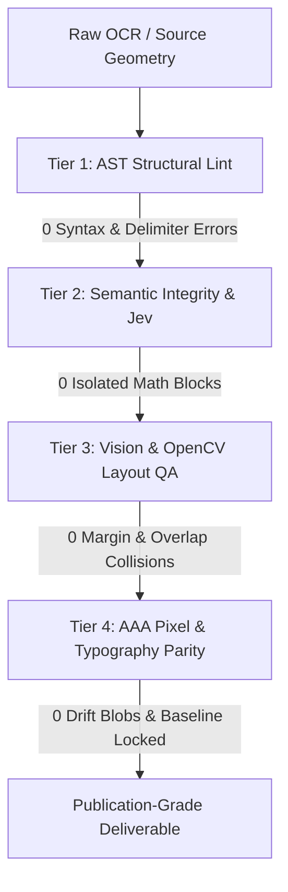

# Verification Workflow: PDF & Academic Monograph Quality

Guidance for validating Markdown-to-Typst/LaTeX mathematical document pipelines. Consult when auditing compiled PDF deliverables, diagnosing layout regressions, or verifying OCR transcriptions.

## Core Hierarchy

Run verification across three distinct tiers in sequence. Every tier must pass its completion criterion before proceeding to the next.



---

## Tier 1: AST Structural Lint (Pre-Layout Gate)

Validate syntactic integrity on the source Markdown before rendering canvas layout.

### Steps
1. Parse math blocks with a formal AST parser (`pandoc -f markdown+tex_math_dollars -t typst`).
2. Scan for illegal whitespace immediately adjacent to inline math delimiters.
3. Validate operator-to-argument transformations.

### Invariants & Reference
- **Inline Delimiter Boundary**: Typst requires `$x$` for inline math and `$\n M \n$` for display math. Adding whitespace `$ x $` forces Typst to isolate the expression onto its own centered line and assign an equation number.
- **Fraction AST Integrity**: LaTeX `\frac{A}{B}` must translate to `frac(A, B)` or `(A)/(B)`. Stripping `\frac` leaves orphaned `{A}{B}` that renders without a division bar.
- **Context Scoping**: Prose formatting (markdown italics `*text*`) and math operators (`*` for multiplication, `!=` for not-equal) operate in mutually exclusive scopes. Apply transformations only to designated token partitions.
- **Equation Number Gating**: Display equation numbers belong only to equations carrying explicit reference labels (`<eq-...>`). Unlabelled derivations remain unnumbered.

### Completion Criterion
AST parser returns exit code 0. Zero occurrences of `$ [A-Za-z0-9] $` inside continuous prose sentences. Zero orphaned `{A}{B}` expressions in math tokens.

---

## Tier 2: Semantic Integrity & Jev (Textual Continuity Gate)

Verify sentence flow, token balance, and paragraph continuity across page boundaries.

### Steps
1. Extract line sequences excluding running headers and folios.
2. Group lines into complete grammatical paragraphs.
3. Inspect sentence transitions across page breaks.

### Invariants & Reference
- **No Isolated Single-Letter Blocks**: A single letter (`a`, `C`, `n`, `z`) never forms an independent display equation. It represents an inline variable belonging to the enclosing sentence.
- **Sentence Continuity Across Folios**: A sentence crossing a page break must not be interrupted by orphaned equation labels, synthetic headers, or duplicate chapter titles.
- **Parenthesis Balance**: Parentheses and brackets opened on a page must balance before the next major section heading. Page-break splits must resolve to matching pairs in the unified stream.
- **Citation Purity**: Bibliographies use hanging indent paragraphs (`hanging-indent: 2.4em, first-line-indent: 0pt`). Bullet points (`*`, `-`, `•`) are prohibited in formal reference sections.

### Completion Criterion
Zero single-variable display equations. Zero unclosed brackets across section boundaries. Zero bullet characters in bibliography listings.

---

## Tier 3: Vision & OpenCV Layout QA (Canvas Geometry Gate)

Audit the rendered 2D canvas geometry using bounding-box analysis and computer vision.

### Steps
1. Render each compiled PDF page at 150 DPI to high-resolution pixmaps.
2. Extract bounding rectangles for all text blocks, formulas, and marginal folios via PyMuPDF / OpenCV contour detection.
3. Measure horizontal extents against the page printable envelope ($W_{\text{text}} \leq 432\text{pt}$ for Crown Octavo $6 \times 9\text{ in}$).
4. Compute pairwise intersections between formula bounding boxes and equation number labels `(xxx)`.

### Invariants & Reference
- **Margin Boundary Envelope**: All text and display equations must remain within the printable text column. Any formula bounding box exceeding `page_width - margin_right` indicates an un-broken line requiring multi-line alignment (`\begin{aligned}`).
- **Label Collision Clearance**: Formula bounding boxes and equation number boxes must maintain a minimum horizontal clearance of 12pt. Bounding box intersection constitutes a layout failure.
- **Visual Line Density**: Blank leaves between chapters must verify to $< 15$ characters and 0 text bounding boxes to prevent hallucinated template text.

### Completion Criterion
Zero bounding box breaches beyond the printable text margin. Zero intersections between equation terms and equation number labels.


---

## Tier 4: AAA Pixel & Typography Parity (Sub-Pixel Ground Truth Gate)

Audit pixel-level layout alignment, punctuation compression, and font outline parity against an authoritative target PDF. Required for critical facsimile reproductions, bilingual facing texts, and woodblock reprints.

Horizontal books use scan parity (`polytypst.parity`). Vertical CJK books use the column audit in `shitouji/check_pixel_alignment.py`.

### Scan parity for horizontal books

Run `uv run polytypst parity BOOK --edition EDITION`. It measures how far each word, line and diagram of the rebuilt PDF sits from the same ink on the source scan, in points, with no shift. `docs/scanned-books.md` gives the procedure, the tolerances, and how to read the report.

### CJK column audit steps
1. Render both the original ground truth PDF and the compiled reproduction PDF at 150 DPI and 300 DPI via `pdftoppm`.
2. Binarize ink channels (`threshold=210` for ground truth, `threshold=230` for vector reproduction).
3. Extract column boundaries and vertical text centroids via morphological projection kernels ($3 \times 35\,\text{px}$).
4. Measure horizontal centroid deviation $\Delta x$ and vertical column extent $\Delta y$ for every text line.
5. Compute 3-channel optical difference map:
   - Gray/Black (`#404040`–`#505050`): Exact ink intersection ($\text{GroundTruth} \cap \text{Reproduction}$).
   - Red (`#E60000`): Ground truth only (original font outlines, embedded background watermarks).
   - Blue (`#0080E6`): Reproduction only (reproduction font outlines, unintended glyph shifts).
6. Apply morphological opening ($4 \times 4\,\text{px}$) to filter 1–2px font serif outline variance and isolate genuine spatial drift blobs ($> 10\,\text{px}$).

### CJK invariants & reference
- **Baseline-Anchored Coordinate Locking**: Place vertical glyphs by true text baseline origin (`origin_y`), never by naive bounding-box top-left or box-centered distribution (`align(center + horizon)`).
  - In Typst: Anchor via `top-edge: "baseline"` with calibrated vertical ascender compensation: `dy = origin_y - 0.97 * sz`.
  - In XeLaTeX: Anchor via zero-depth picture primitives: `\put(x, -y){\makebox(0,0)[lt]{...}}`.
- **Punctuation Half-Width Compression**: Vertical closing punctuation (`。`, `，`, `」`, `〉`, `』`) and middle colons (`‥`) must retain half-width vertical advance ($6.98\,\text{pt}$ for $13.95\,\text{pt}$ body cells). Full-width advance adds $6.5\,\text{pt}$ per occurrence, producing catastrophic column overflow ($> 50\,\text{pt}$).
- **Vertical Bracket Preservation**: Fullwidth vertical parentheses and brackets (`（`, `）`, `︵`, `︶`, `﹇`, `﹈`) must preserve their vertical presentation forms (`U+FE35`, `U+FE36`). Restrict NFKC normalization solely to CJK compatibility ideographs (`0xF900`–`0xFAFF`, `0x2F800`–`0x2FA1F`). Never allow Unicode normalization to degrade vertical brackets to ASCII `(` or `)`.
- **Font Outline Tolerance Budget**: Two different CJK typefaces (e.g. Tsukushi Mincho vs. Songti TC) will display 1–2px anti-aliasing edge fringes in $A - B$ subtraction due to differing serif curves. An audit passes when the character center is solid dark gray/black and large drift blobs ($> 10\,\text{px}$) equal zero.
- **Strict Column Tolerances**: Horizontal column pitch error $\Delta x \le 0.50\,\text{pt}$ ($0.16\,\text{mm}$). Column bottom line clearance error $\Delta y_{\text{bot}} \le 2.0\,\text{pt}$ ($0.70\,\text{mm}$).

### Completion Criterion
Scan parity: `polytypst parity` exits with status 0 for the edition.

CJK column audit: the OpenCV automated audit reports:
- Column spatial centroid drift $\Delta x \le 0.50\,\text{pt}$ on all body columns.
- Zero column layout drift blobs ($> 10\,\text{px}$) outside font serif fringes.
- Zero character overflow breaches beyond the page foot margin ($y \le 690.0\,\text{pt}$ on $728.5\,\text{pt}$ JIS B5 sheet).
- Folio leaf brackets verify as horizontal capping arcs (`︵`, `︶`) with ink intersection overlap $\ge 65\%$.
---

## Automated Verification Command

Run the consolidated multi-tier audit tool against any deliverable:

```bash
PYTHONPATH=polytypst uv run --with pymupdf python3 -m polytypst.checker <path_to_pdf>
```

A clean audit report reports:
```
================ STRICT QUALITY CHECK REPORT ================
Total Issues: 0 (0 Errors, 0 Warnings)
Result: PASSED
============================================================

To run Tier 4 sub-pixel ground truth alignment and visual difference mapping:

```bash
uv run --with opencv-python --with numpy python3 shitouji/check_pixel_alignment.py
```

A clean Tier 4 audit reports:
```
Detected Vertical Columns: Orig = 19, Reproduction = 19
Col 01: Δx = -0.24 pt | Δy_top = +1.44 pt | Δy_bot = +1.44 pt | [PASS]
Ink Pixel Overlap (IoU): > 35%
Layout Drift Blobs (>10px): 0
```
```
