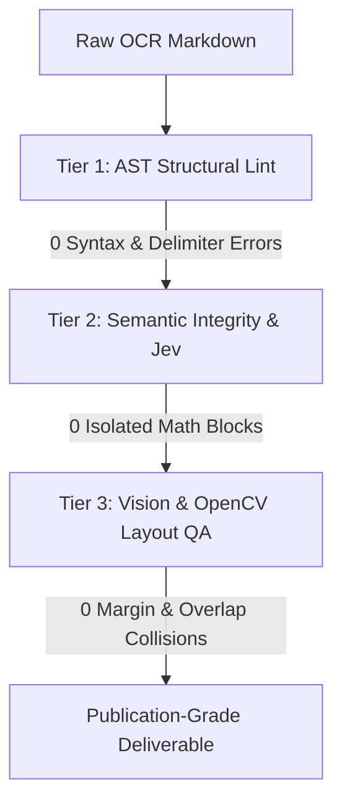

# Verification Workflow: PDF & Academic Monograph Quality

Guidance for validating Markdown-to-Typst/LaTeX mathematical document pipelines. Consult when auditing compiled PDF deliverables, diagnosing layout regressions, or verifying OCR transcriptions.

## Core Hierarchy

Run verification across three distinct tiers in sequence. Every tier must pass its completion criterion before proceeding to the next.



---

## Tier 1: AST Structural Lint (Pre-Layout Gate)

Validate syntactic integrity on the source Markdown before rendering canvas layout.

### Steps
1. Parse math blocks with a formal AST parser (`pandoc -f markdown+tex_math_dollars -t typst`).
2. Scan for illegal whitespace immediately adjacent to inline math delimiters.
3. Validate operator-to-argument transformations.

### Invariants & Reference
- **Inline Delimiter Boundary**: Typst requires `$x$` for inline math and `$\n M \n$` for display math. Adding whitespace `$ x $` forces Typst to isolate the expression onto its own centered line and assign an equation number.
- **Fraction AST Integrity**: LaTeX `\frac{A}{B}` must translate to `frac(A, B)` or `(A)/(B)`. Stripping `\frac` leaves orphaned `{A}{B}` that renders without a division bar.
- **Context Scoping**: Prose formatting (markdown italics `*text*`) and math operators (`*` for multiplication, `!=` for not-equal) operate in mutually exclusive scopes. Apply transformations only to designated token partitions.
- **Equation Number Gating**: Display equation numbers belong only to equations carrying explicit reference labels (`<eq-...>`). Unlabelled derivations remain unnumbered.

### Completion Criterion
AST parser returns exit code 0. Zero occurrences of `$ [A-Za-z0-9] $` inside continuous prose sentences. Zero orphaned `{A}{B}` expressions in math tokens.

---

## Tier 2: Semantic Integrity & Jev (Textual Continuity Gate)

Verify sentence flow, token balance, and paragraph continuity across page boundaries.

### Steps
1. Extract line sequences excluding running headers and folios.
2. Group lines into complete grammatical paragraphs.
3. Inspect sentence transitions across page breaks.

### Invariants & Reference
- **No Isolated Single-Letter Blocks**: A single letter (`a`, `C`, `n`, `z`) never forms an independent display equation. It represents an inline variable belonging to the enclosing sentence.
- **Sentence Continuity Across Folios**: A sentence crossing a page break must not be interrupted by orphaned equation labels, synthetic headers, or duplicate chapter titles.
- **Parenthesis Balance**: Parentheses and brackets opened on a page must balance before the next major section heading. Page-break splits must resolve to matching pairs in the unified stream.
- **Citation Purity**: Bibliographies use hanging indent paragraphs (`hanging-indent: 2.4em, first-line-indent: 0pt`). Bullet points (`*`, `-`, `•`) are prohibited in formal reference sections.

### Completion Criterion
Zero single-variable display equations. Zero unclosed brackets across section boundaries. Zero bullet characters in bibliography listings.

---

## Tier 3: Vision & OpenCV Layout QA (Canvas Geometry Gate)

Audit the rendered 2D canvas geometry using bounding-box analysis and computer vision.

### Steps
1. Render each compiled PDF page at 150 DPI to high-resolution pixmaps.
2. Extract bounding rectangles for all text blocks, formulas, and marginal folios via PyMuPDF / OpenCV contour detection.
3. Measure horizontal extents against the page printable envelope ($W_{\text{text}} \leq 432\text{pt}$ for Crown Octavo $6 \times 9\text{ in}$).
4. Compute pairwise intersections between formula bounding boxes and equation number labels `(xxx)`.

### Invariants & Reference
- **Margin Boundary Envelope**: All text and display equations must remain within the printable text column. Any formula bounding box exceeding `page_width - margin_right` indicates an un-broken line requiring multi-line alignment (`\begin{aligned}`).
- **Label Collision Clearance**: Formula bounding boxes and equation number boxes must maintain a minimum horizontal clearance of 12pt. Bounding box intersection constitutes a layout failure.
- **Visual Line Density**: Blank leaves between chapters must verify to $< 15$ characters and 0 text bounding boxes to prevent hallucinated template text.

### Completion Criterion
Zero bounding box breaches beyond the printable text margin. Zero intersections between equation terms and equation number labels.

---

## Automated Verification Command

Run the consolidated multi-tier audit tool against any deliverable:

```bash
PYTHONPATH=polytypst uv run --with pymupdf python3 -m polytypst.checker <path_to_pdf>
```

A clean audit report reports:
```
================ STRICT QUALITY CHECK REPORT ================
Total Issues: 0 (0 Errors, 0 Warnings)
Result: PASSED
============================================================
```
